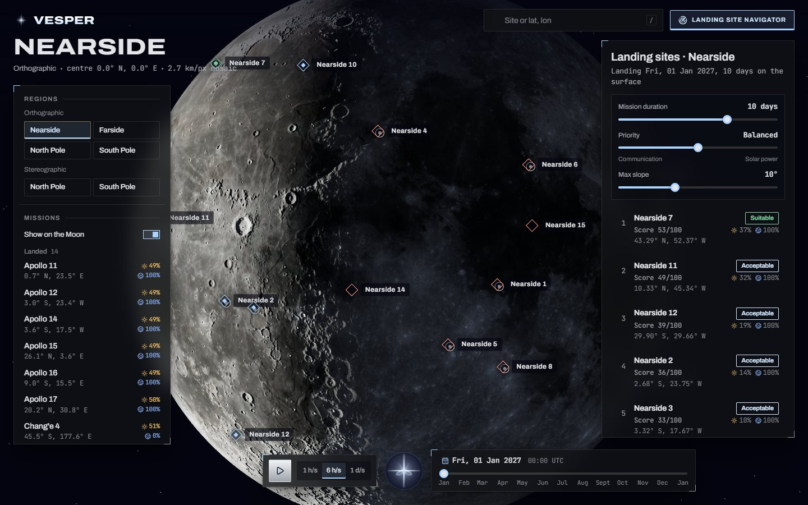
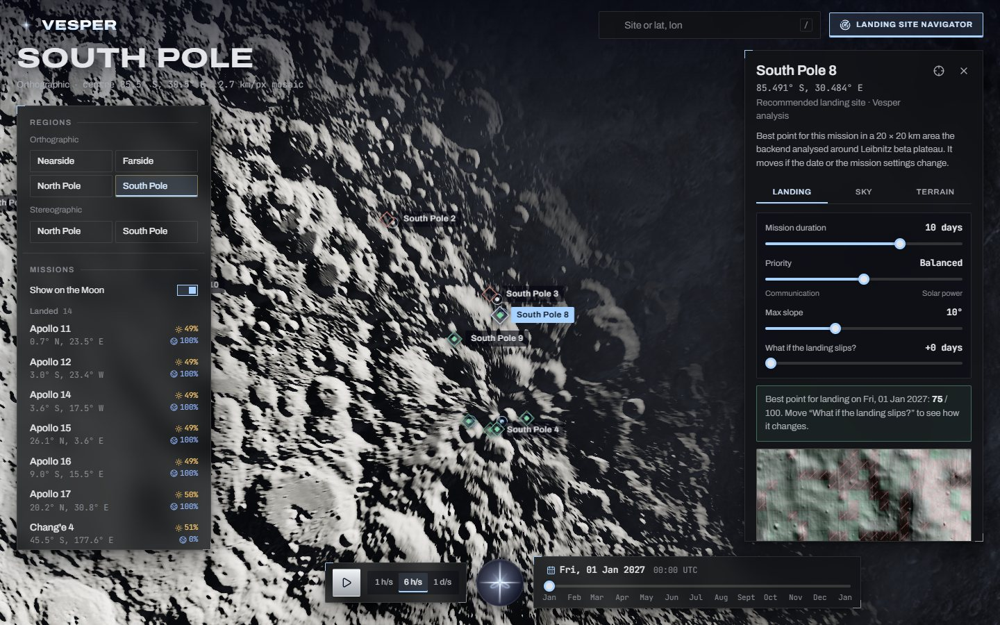
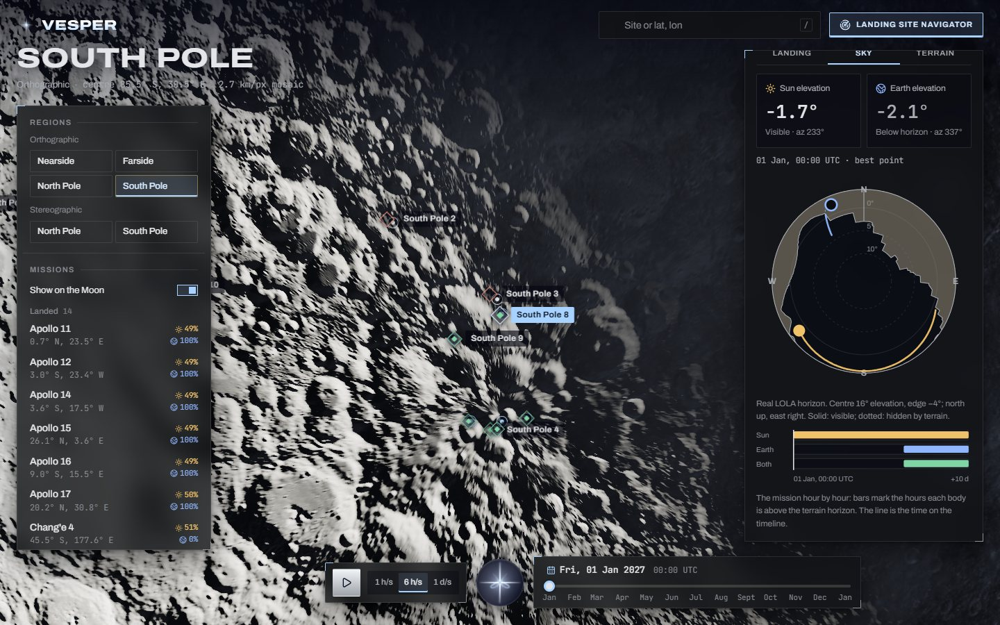
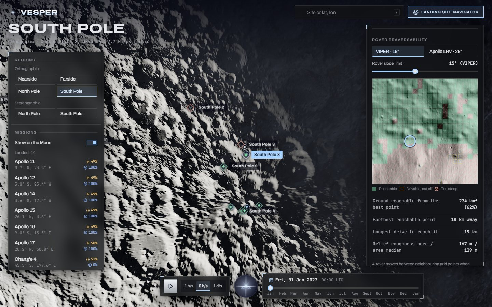

# Vesper

**Tell Vesper where you are going and when. Vesper tells you where to land.**

Vesper is a lunar landing-site navigator built by team **Vesper – Fortuna** for the
**2026 NASA Space Apps Challenge** ("Lunar Landing Site Navigator"). It shows where the Sun and
the Earth sit against the **real terrain horizon** of any point on the Moon, for any hour of 2027,
and it **recommends landing sites** for a given mission window by scoring sunlight (power),
direct-to-Earth visibility (communications) and slope (safety).

- **Live app:** https://vesper-fortuna.vercel.app/
- **Code:** this repository (frontend in `frontend/`, data pipeline and server in `data-pipeline/`)

| | |
|---|---|
|  |  |
|  |  |

## The problem

Missions to the lunar south pole face extreme lighting and communication constraints: the Sun skims
the horizon and the Earth rises and sets with libration, so a few hundred metres or a few days can
decide whether a lander has power and a link home. When a launch slips, planners must re-evaluate
sites and dates quickly, but the tools that hold the data (QuickMap, Moon Trek, JPL Horizons) are
built for detailed analysis one point at a time.

## What Vesper does

- **3D Moon** (LROC colour, LOLA relief) lit by the true Sun direction and with the Earth at its true
  position for the selected hour (JPL Horizons).
- **Landing site navigator:** recommends sites for the region in view, coloured by verdict
  (suitable / acceptable / not recommended), for the chosen landing date, mission length, priority
  (balanced, power, communications) and maximum slope.
- **"What if the landing slips?"** slider (0–29 days): scores and the best site update instantly.
  Example: a top site on the Connecting ridge drops from 56 to about 2 with a one-week delay, and
  Vesper points to a better spot nearby.
- **Any coordinate:** click the Moon or type `lat, lon` to get the verdict and its reasons, sunlight
  and Earth contact, countdowns to sunset and Earthset, and solar energy for a vertical versus a
  horizontal panel. With the backend server running, that exact point is analysed live. Without it
  (as in the hosted app) Vesper answers with the nearest point of a precomputed grid of about 2,600
  points covering the whole Moon, and says how far that point is.
- **Site panel:** aptitude heat map with the top 3 points, sky dial with the real LOLA horizon, hourly
  Sun/Earth/both bands, terrain relief and slope distribution, and rover traversability.
- **22 catalogued sites:** Apollo 11–17, Chang'e 4/5/6, Chandrayaan-3, SLIM, IM-1, IM-2, Blue Ghost 1,
  six south-pole candidate regions and two north-pole regions, each with its source.
- **Voice assistant** (Web Speech API, en-US) that answers only with computed values.

## How it works

1. **Ephemeris.** JPL Horizons (DE441 lunar model) gives the Sun direction and the Earth position in
   the Moon-fixed frame every hour of 2027 (`ephem_global.npz`). Earth parallax between sites is
   handled by storing its position, not just its direction.
2. **Terrain.** For each point, a 360° terrain horizon is ray-cast over NASA Moon Trek LOLA DEMs up to
   150 km away with exact lunar curvature (no atmosphere, so no refraction). The DEM is chosen by
   latitude: 30 m/px polar DEMs beyond 60°, the 128 ppd global DEM elsewhere. Files of several GB
   are read in windows, so it runs on a laptop.
3. **Visibility.** A body counts as visible when the centre of its disk is above the terrain horizon,
   for an observer 2 m above the ground.
4. **Score (0–100)** = 100 × (0.40 · %Sun + 0.25 · %Earth + 0.15 · %both + 0.20 · longest continuous
   sunlight / mission length), with presets that shift the weights. Verdict: *not recommended* if the
   slope exceeds the limit or the score is under 30; *suitable* from 50.
5. **Energy.** Incident solar energy (1361 W/m²) for a sun-tracking vertical panel (∝ cos elevation)
   versus a horizontal panel (∝ sin elevation). At the pole the horizontal panel gets almost nothing.

Precomputed regions (21 × 21 points, 1 km apart, every hour of 2027) feed the app directly; the Python
server (`data-pipeline/server.py`) answers any other coordinate in about a second, offline.

## Validation

| Check | Result |
|---|---|
| Our hourly Sun percentage vs. the official LOLA average-illumination map (the layer shown in QuickMap), 7 south-pole regions | **Correlation 0.927** over 3,086 points; regional means within 0–2.4 percentage points |
| Moon Trek DEM elevation vs. elevations published by the LROC team | Chang'e 6 −5,264 vs −5,256 m · Chang'e 4 −5,931 vs −5,927 m · SLIM −927 vs −912 m · IM-1 2,598 vs 2,579 m |
| Precomputed ephemeris vs. direct JPL Horizons queries at 5 sites across the Moon | Sun within 0.001°; Earth exact |

## NASA and space agency data

| Resource | Used for |
|---|---|
| [JPL Horizons](https://ssd.jpl.nasa.gov/horizons/) | Sun and Earth positions, every hour |
| [NASA Moon Trek](https://trek.nasa.gov/moon/): `LRO_LOLA_DEM_SPole75_30mp_v04_EQ`, `LRO_LOLA_DEM_NPole75_30mp_v04_EQ`, `LRO_LOLA_DEM_Global_128ppd_v04` | Elevation, slope and terrain horizon |
| [LROC QuickMap](https://quickmap.lroc.im-ldi.com/) / LROC featured images and NAC DTMs | Validation layers and landing-site coordinates |
| [NASA GSFC PGDA](https://pgda.gsfc.nasa.gov/products/90) (LOLA south-pole products, illumination maps) | Candidate-site centres and validation |
| [NASA NSSDCA](https://nssdc.gsfc.nasa.gov/planetary/lunar/lunar_sites.html) | Apollo landing coordinates (Wagner et al. 2017) |
| [NASA SVS 4720](https://svs.gsfc.nasa.gov/4720/) and [3615](https://svs.gsfc.nasa.gov/3615/) | Moon and Earth textures |
| [Canadian Space Agency, Moon exploration](https://www.asc-csa.gc.ca/eng/astronomy/moon-exploration/) | Mission context (Artemis participation, lunar rover delays) |
| ISRO, JAXA, CNSA mission information | Chandrayaan-3, SLIM and Chang'e sites in the catalogue |

Full list with per-file usage: [`frontend/REFERENCES.md`](frontend/REFERENCES.md).

## Run it locally

**Frontend** (Node 22):
```bash
cd frontend
npm install
npm run dev          # http://localhost:5173
```

**Backend server** (Python 3.10+), needed only for arbitrary coordinates:
```bash
cd data-pipeline
pip install -r requirements.txt
# download the three DEMs from Moon Trek into data-pipeline/ (not in git, ~4.2 GB):
#   https://trek.nasa.gov/moon/TrekWS/rest/cat/data/stream?label=<file name without .tif>
python server.py --dem-south "LRO_LOLA_DEM_SPole75_30mp_v04_EQ.tif" \
                 --dem-north "LRO_LOLA_DEM_NPole75_30mp_v04_EQ.tif" \
                 --dem-global "LRO_LOLA_DEM_Global_128ppd_v04.tif"
```
API reference: [`data-pipeline/API.md`](data-pipeline/API.md). The hosted app works without the
server: the 22 sites, the recommended areas and a global grid for custom coordinates are precomputed.
The server adds the exact analysis of any coordinate. With both on one machine the app finds it at
`localhost:8000`; a hosted build reads its address from the `VITE_VESPER_API` variable (see
[`frontend/README.md`](frontend/README.md)).

Recompute regions: `python grid_region.py --regions regions.json --dem-south ... --dem-north ...
--dem-global ... --ephem ephem_global.npz --out ../web/data`, then `npm run sync:backend` in `frontend/`.

## Repository layout

```
frontend/        Main app: Vite + React + TypeScript + three.js (see frontend/README.md)
data-pipeline/   Python: ephemeris, DEM reader, horizon, grids, point engine, HTTP server (see data-pipeline/README.md)
web/data/        Precomputed regions, exactly as the pipeline wrote them
docs/            Screenshots
```

## Limitations

- Data covers 2027 hourly (regenerate `ephem_global.npz` for other years).
- Slope is measured at DEM scale (30–237 m), not rover or lander scale; terrain beyond 150 km is ignored.
- Relay satellites are not modelled: far-side sites correctly show 0 % direct Earth visibility.
- Chandrayaan-3 and the two north-pole coordinates are marked for verification in QuickMap.

## Use of AI

Parts of the code, documentation and data pipeline of this project were developed with the help of
AI assistants (Anthropic's Claude, including Claude Code). The team defined the idea, chose the data
and methods, ran and validated the computations against NASA data, and reviewed the results. No
AI-generated images, audio or NASA branding are used in the app.

## License

See [LICENSE](LICENSE). NASA data and imagery are credited in `frontend/REFERENCES.md`.
